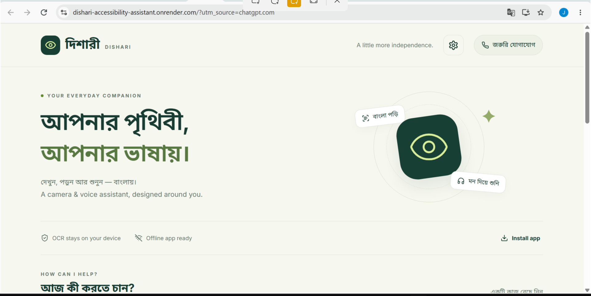

# দিশারী · Dishari


**A Bangla-first multimodal accessibility research prototype.** Read printed Bangla and English, listen to documents, inspect medicine-label text, and explore local camera-based AI — from one accessible interface.

Built with **React 19, Vite, Tesseract.js, PDF.js, Web Speech APIs, FastAPI, optional YOLO and Ollama**. This is an installable progressive web app (PWA), not a Flutter/React Native app or a compiled APK. It runs on Windows browsers and compatible Android browsers. Local features require no cloud AI account. Optional Gemini scene descriptions require a Gemini API key.

## Start in two minutes

Install Node.js **22.12+**. Extract the project once, then run `scripts/start-windows.cmd`, or use:

```bash
cd frontend
npm ci
npm run setup:offline
npm run build
npm run preview
```

Open **http://localhost:4173**. Select **লেখা পড়ুন** and upload a clear JPG/PNG. Bangla/English OCR works without the Python backend. Wait for **Offline app ready** before disconnecting the network. The initial dependency setup needs internet; subsequent OCR uses bundled local models.

The supplied ZIP also includes `frontend/dist`: run `scripts/preview-prebuilt-windows.cmd` if you have Python 3.11/3.12 and want to try the built app without installing Node dependencies. Source builds remain the recommended development path.

**Full Bangla Windows instructions:** [docs/RUN_BANGLA.md](docs/RUN_BANGLA.md).

## Feature status — what actually runs

| Feature | Implementation | Requirements and limits |
|---|---|---|
| Bangla commands | Bengali keyword intent routing over Web Speech recognition | Browser/device dependent; offline Bangla speech often unavailable. Remote recognition requires opt-in. Buttons always work. |
| Scene description | Local Ollama, explicit Gemini online mode, or YOLO object summary | Requires configured backend and downloaded model. Object summary is clearly identified as a fallback. |
| Bangla OCR | Tesseract.js `ben+eng`, processed on device | Bundled models; printed text, clear photos. Not a handwriting specialist. |
| Currency reading | OCR digits with a currency-context check and ambiguity rejection | A tentative reading, not an independent banknote classifier or authenticity detector. |
| Medicine-label reading | Local OCR plus highlighted strength/expiry/batch lines | Reads visible text; does not identify pills, validate expiry, or recommend dosage. |
| Obstacle alert | Optional YOLO detection with left/center/right positions | Experimental **single-image object alert**, not live navigation or distance estimation; no clear-path claims. |
| Documents | Images, PDF text extraction, OCR for scanned PDF pages | Maximum 10 MB, 20 PDF pages; embedded PDF fonts/text may affect Bangla extraction. |
| Emergency contact | Local contact settings and confirmed `tel:` dial action | No automatic dispatch, location sharing, or silent call. Depends on phone/dialer. |
| Offline mode | Precache app, OCR worker, WASM cores, and language models | Production build on localhost/HTTPS; first cache must finish. AI requires a reachable local backend. |
| Text-to-speech | Device/browser speech synthesis, sentence playback and stop | Requires installed Bangla voice; local-only voices are preferred by default. |

There are no fabricated detections, bundled evaluation results, or claims of clinical/navigation reliability. This repository is a runnable research prototype; it still needs testing with consenting target users and target phones.

## Optional online scene descriptions

Gemini integration is available for low-resource computers. It sends only user-selected scene images to Google and keeps the key in backend configuration. See [docs/GEMINI_SETUP_BANGLA.md](docs/GEMINI_SETUP_BANGLA.md). Choose `SCENE_PROVIDER=gemini`; the default `local` path retains YOLO/Ollama. Cloud usage depends on your account quota/billing and internet connection.

## Python backend

Use Python **3.11 or 3.12**. In a second terminal:

```bash
cd backend
python -m venv .venv
# Windows CMD:
.venv\Scripts\activate
# Linux/macOS instead: source .venv/bin/activate
pip install -r requirements.txt
python -m uvicorn app.main:app --host 127.0.0.1 --port 8000
```

API docs: **http://localhost:8000/docs**. In the app, open Settings → Test connection. A healthy API does not mean its optional models are loaded.

### Enable object detection

In the activated backend environment:

```bash
pip install -r requirements-ai.txt
python download_model.py
```

Restart the backend. Its health endpoint should show `detector: true`. Now **সামনের বস্তু** runs real YOLO inference. Scene mode returns a Bangla list of detected objects if no vision-language model is configured. CPU inference works but depends on hardware; PyTorch installation is significantly heavier than OCR.

### Enable full scene description

Install [Ollama](https://ollama.com/), then download a vision model supported by your machine:

```bash
ollama pull llama3.2-vision
```

This model needs substantial RAM; use a machine with enough resources. Copy `backend/.env.example` to `backend/.env` and set:

```dotenv
OLLAMA_VISION_MODEL=llama3.2-vision
OLLAMA_URL=http://localhost:11434
```

Run:

```bash
python -m uvicorn app.main:app --host 127.0.0.1 --port 8000 --env-file .env
```

After model downloads, these local inference paths need no cloud connection. Language-model output can still hallucinate and its Bangla quality must be evaluated.

## Development and tests

```bash
cd frontend
npm ci
npm run setup:offline
npm run dev
npm test
npm run build
```

The development server is at `localhost:5173`. It intentionally does not register a service worker. Use the production preview for offline testing.

```bash
cd backend
python -m pytest -q
```

Optional reproducible browser checks are in `scripts/browser-smoke.cjs`; see [docs/TESTING.md](docs/TESTING.md). They exercise real local English OCR, PDF extraction, responsive layout, and cached offline reload. Bangla OCR assets and a Bangla fixture are also included; readability and accuracy still need a proper dataset. See [docs/EVALUATION.md](docs/EVALUATION.md) for CER/WER, task-success evaluation, accessibility, and failure analysis.

## Mobile / install

Use Chrome/Edge on **HTTPS or localhost**. Install from the browser's install/Add to Home Screen menu. Installation and voice support vary across browsers. A LAN `http://192.168.x.x` URL is not a secure camera origin; file upload may still work there.

For Android USB testing, `adb reverse tcp:4173 tcp:4173` and `adb reverse tcp:8000 tcp:8000` let the phone use `http://localhost:4173` and the local backend. See the Bangla guide. This project does not include a signed Play Store package.

## Docker (optional lightweight demo)

```bash
docker compose up --build
```

Open `http://localhost:4173`. The lightweight Docker backend excludes YOLO/PyTorch and Ollama. OCR/document/currency/label reading work in the frontend; install the Python AI path to enable object detection. Docker binds to localhost by default.

## Privacy and accessibility

See the [Accessibility Statement](ACCESSIBILITY.md) for supported features, limitations, privacy details, and testing status.

- OCR, PDF extraction and document text stay on the device unless the user explicitly downloads a text file.
- Scene/object images are sent only to the configured backend; the backend does not retain images. Multipart uploads may use temporary files, which are closed after requests.
- The app caches code and OCR models, not captured photos or reading history.
- Settings and emergency contact live in localStorage. Optional backend API keys also stay there; don't save sensitive keys on shared devices.
- Remote browser speech services may receive audio, only after explicit opt-in. Voice provider behavior is outside this app's control.
- Large tap targets, labeled controls, keyboard focus, modal focus traps, skip link, high-contrast/large-text settings, reduced-motion handling and visible speech fallbacks are implemented. Formal WCAG/TalkBack testing is still required.

Do not expose the development backend publicly as-is. For deployment, use HTTPS, an API key, explicit CORS origins, a reverse-proxy upload limit/rate limit, and reviewed hosting configuration.

## Live Demo

- **Frontend:** https://dishari-accessibility-assistant.onrender.com
- **Backend API health:** https://dishari-backend-drch.onrender.com/api/health

The live frontend and backend connectivity have been verified. Gemini-powered scene descriptions are configured on the deployed backend; successful responses should be tested in the live app. The deployed health endpoint currently reports `detector: false`, so live YOLO object detection is **not currently available**. Object detection requires the model and its dependencies to be installed and configured in the deployed backend. Local object detection setup is documented above.

**Privacy note:** When Gemini scene description is used, the selected image is sent to Google for processing. See the [Accessibility Statement](ACCESSIBILITY.md) for privacy, accessibility, and safety limitations.

## GitHub upload

This project is committed in small, reviewable steps. Before pushing, verify the repository URL and inspect `git status`.

Never commit `.env` files, API keys, virtual environments, `node_modules`, generated build output, or downloaded model binaries.

See [docs/RUN_BANGLA.md](docs/RUN_BANGLA.md) for Windows setup instructions and [docs/TESTING.md](docs/TESTING.md) for browser checks.

## Structure

```text
dishari/
  frontend/     React PWA, local OCR, PDF reader, speech, accessible interface
  backend/      FastAPI, optional YOLO and local vision-model integrations
  scripts/      Windows launchers, evaluation and browser checks
  docs/         Bangla setup, architecture, evaluation, testing
  samples/      Synthetic non-personal test documents
```

## Roadmap

Train and validate a Bangladesh-banknote classifier; benchmark Bangla OCR by lighting/font; add an audited on-device Bengali ASR model; evaluate camera guidance with blind users; add native Android integrations if browser limitations block usability. Do not equate implemented screens with validated social impact.

## License and upstreams

This project is released under **AGPL-3.0-or-later**, compatible with the intended open-source YOLO integration. Third-party packages/models retain their own licenses. See [THIRD_PARTY.md](THIRD_PARTY.md). Model selection and distribution require checking each model's current license.
